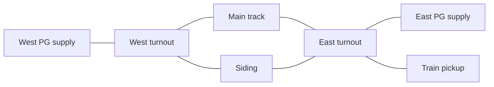

# Catenary networks

Power Dock can run overhead wires around a loop, split them at a turnout, rejoin them, and feed the same railway from several substations. Any ordinary hanger can serve as a junction or a feed point. Power Grid solves the circuit formed by the actual sources, trains, and both overhead conductors.

## A passing loop with two feeders

Each line in the drawing represents a pair of conductors. With the train at the east turnout, both supplies can contribute. Current arriving from the west can use the main and the siding simultaneously. Cutting the main sends that current through the siding. Cutting both routes isolates the west supply from the train. The east supply can still power it.

### Building it in game

1. Place a hanger on the approach to each turnout, then place hangers along the main and siding as needed. One approach hanger can serve both exits, even when their wires initially leave in the same direction.
2. Hold bare Power Grid Copper Wire. Sneak-right-click the two hangers for a span in either order. If the tracks offer two routes between them, sneak-right-click a rail on the leg you want. The preview follows that leg. Add another rail waypoint if needed, then confirm on the destination hanger. Sneak-right-click in the air to cancel. Each confirmed route can cover up to 64 blocks of track.
3. To close the loop, link back to a hanger that already has wires. To add a supply, wire its positive and negative connections to the corresponding posts on any hanger. Normal PG wire connections also let a stationary device draw from the line.
4. To cut one span, open the hanger settings from the rail, select the connection by its highlighted route, and confirm removal. This also distinguishes two routes with the same endpoints. Breaking a hanger removes its attached spans. Trains can traverse intact routes in either direction.

## What gets saved

In beta3, `CatenaryLines` gives each destination one incoming span. The pantograph follows that span's ancestry and makes a direct electrical connection to its feeder. The new circuit taps the wire at the train's position so parallel paths and multiple feeders can share the load.

Save an **undirected graph per dimension**. A confirmed span has its own stable ID, two hanger anchors, its ordered Create track-edge intervals and its conductor orientation. Each hanger indexes every attached span. Reversing a route gives the same identity for duplicate detection. Two genuinely different routes between the same hangers are distinct spans. Both endpoints may already belong to the same network or to two networks the player is joining.

The 64-block length limit applies per placement. Replace the old 32-hanger ancestry limit with bounded work per route search. If a dense yard uses up the search budget, ask for a waypoint on the intended leg. Store the exact previewed route and revalidate it on confirmation so a switch edit cannot commit a different path.

Derive the physical wire runs from those records. If two links from a hanger share track up to the switch, create one common wire pair up to the actual divergence and two pairs beyond it. Apply the same rule backwards at a rejoin. Split intervals at real hangers and at those shared junctions. Record which confirmed spans use each interval so removing one route keeps copper still used by the other. Nearby parallel tracks, flyovers and diamond crossings acquire no electrical link from proximity. If a proposed route overlaps an independent wire pair at the same height, show the conflict in the preview and require an explicit connection at a hanger.

Give each shared junction one wire height above the rail. For a turnout between real hangers, use the clearance of the nearest attached hanger along the wire, with a stable anchor tie-break. Interpolate to the other hangers relative to the rail through curves and grades. Preview any shared geometry that will move. Record supply and return by terminal identity. Reversing a span or driving a train backwards must always connect terminal 0 to supply and terminal 1 to return. Where closing a turning loop exchanges the physical sides, use an insulated crossover inside the hanger head to join like terminals while keeping the pickup surfaces separate.

## How Power Grid sees the railway

- Represent each physical run as two resistors, one for supply and one for return. Use a length-based copper resistance. The proposed rate is PG bare wire's resistance per item multiplied by items per metre, applied to the length of each conductor. Splitting a run divides its resistance in proportion to length. A span shared by two routes contributes its resistance once.
- Attach each loaded hanger's PG posts at their actual location. A connected source, battery, open breaker or load can remain present at zero volts. Each post participates independently through the player's PG wiring. Sources on one section are in parallel through the overhead impedance. Their terminal voltages and circuit resistances determine current, including possible backfeed between unequal sources with no train present.
- Attach a raised pantograph where its shoes touch one wire pair. Split the two line resistors at that location and add the existing 0.04 Ω pickup resistance per shoe. Multiple trains at different positions create multiple taps. Coincident taps share the same local line nodes and retain separate shoe resistances. While a pickup stays between the same neighbours, update the adjacent resistances in place. At a junction it uses the junction nodes directly, avoiding a zero-length resistor.
- Select contact from the nearby wire index. Through a turnout, prefer the carriage's occupied track when available and use continuity of the previous contact to resolve overlap on the shared run. A generic Sable carriage can use wire geometry and continuity. An unresolved tie between electrically separate lines opens the pickup. Contact requires both shoes on the same pair. The contact lamp reports contact, and a PG meter reports voltage.

Use Power Grid's solver on the server. The pinned PG 0.6.2 jar exposes `OwnedFloatingNode`, `WorldNetworks.prepareForConnection`, `ElectricWire.setResistance` and `scheduleIslandDiscovery`. Use runtime-owned junction and tap nodes plus the real PG endpoints on loaded blocks. One owner per physical run maintains both conductors. Apply contact moves, cuts and additions together before a solve. If either half of an attachment fails, release both halves. On removal, retire wires and unused nodes and ask PG to rediscover electrical islands. Power Dock can do this directly with its existing dependencies. Prove that lifecycle against the pinned runtime in the first implementation step.

## Chunks, edits and cost

The saved graph carries the line through unloaded intermediate chunks. Keep each generator you want contributing, its PG wiring and its feeder connection loaded. Unloading one feeder detaches its real posts. The other feeders and the wire passing through that location still work. A ghosted Loconautics train releases its tap and reacquires one when its carriage exists under the wire again.

Collapse successive passive runs in series by adding their resistances. Retain junctions, attached posts and working pickups. Keep parallel routes through a loop in the circuit. Hold layout data for an unused section and create its solver elements when it gains external connections. Two connected supplies count even with no pickup. If PG cannot reliably report outside attachments, retain loaded hanger posts as circuit nodes. This preserves meter readings, third-party loads and single-post connections.

Index runs by occupied chunk and by track edge. Train ticks query the pickup's local wire index. Layout edits update the affected routes and electrical component. A cut in a ring may require walking that component once to determine whether it split. Moving a train only changes its local taps. Send cached geometry to players watching chunks the wires cross, including where both endpoint hangers are outside view. The client can render a shared interval once from its ID and revision.

Store only layout and route state on disk. Recreate solver elements after the level and PG are ready. A missing chunk alone leaves its spans intact. Track removal suspends links that use the missing track. A shared run still carries power if an intact confirmed route uses it. When Create changes a track graph ID, rebind to matching physical edges. A changed path calls for a new preview before power can follow it. Check permissions and route revisions again on confirmation.

## Existing worlds and implementation checks

Import each saved `From`/`To` link once, preserving endpoints, heights, geometry, terminal mapping and suspended state. Import older block-only links as their endpoints load. Persist removals and the migration version so a late-loading hanger cannot restore a cut span. Existing feeder wiring then attaches at that same hanger. Long runs may deliver a different voltage because pickups now draw through the intervening copper.

| Step | Evidence to collect |
| --- | --- |
| 1. Prove the circuit | Connect two real PG sources and a load on a fixed passing loop. Compare signed feeder currents, branch currents and load voltage with an equivalent PG resistor circuit. Cut either arm, cut both, disconnect each source, and check unequal voltages with no train. |
| 2. Prove the construction | Build a main and siding between the same two hangers in both click orders. Check branch choice, closing the last span, reverse-order duplicates, removal of just one arm, shared copper and a crossing that stays isolated. Repeat after saving and reopening. |
| 3. Drive it | Drive a pantograph-only Loconautics train over each exit and rejoin in both directions, then through a reversing loop. Check signed onboard voltage and current through the switch, both shoes on their conductors, and two trains drawing at once, including when their taps meet. |
| 4. Unload and change it | Unload all intermediate hanger chunks with only the two supplies and their feeders kept loaded. Unload a feeder, reload it, cut and restore track, restart, and repeat on an upgraded beta3 world. Check for stale current paths, duplicate nodes and unexpected chunk tickets. |
| 5. Measure it | Compare the same route and train count on the current build and the proposed build. Record server tick times, PG solve time, live node and wire counts, topology edits per tick, and client frame times. Add an idle distant yard and check that local contact queries and render work stay local. |

For a numerical check, take two 24 V supplies with 1 Ω series resistance each, a main with 2 Ω round trip, a siding with 4 Ω round trip, and 10 Ω across the east junction including pickup contacts. Split the route resistance equally across supply and return. With all connections closed, the load should see 22.43 V across that 10 Ω and the west and east feeders should supply 0.67 A and 1.57 A respectively. Disconnect the east source and cut the main, and the west source should supply 1.60 A through the siding. These are calculated reference values for the proposed tests.

For a fresh-process check, pass `-PcatenaryRecoveryRun=<name>` and `-PcatenaryRecovery=save` to the Loconautics GameTest run. Run again with the same name and `-PcatenaryRecovery=restore`. Use a different run name and the phases `save-beta3` and `restore-beta3` to check the old `Links` format. The test saves real Power Grid hanging wires in a disposable world. The restore phase reapplies the two feeder chunk tickets for GameTestServer and checks that the west source still supplies the east load after the east source is removed.
